# 🔌 OKTE - Slovak Energy Market Integration for Home Assistant

[](https://github.com/jozef-moravcik-homeassistant/okte)
[](https://github.com/hacs/integration)
[](LICENSE)

> 📖 **[Slovenská verzia dokumentácie / Slovak Documentation →](README_SK.md)**

---

## 📋 Introduction

**OKTE Integration** is a comprehensive Home Assistant custom integration that provides automatic data retrieval from the Slovak Energy Market (OKTE - Operátor krátkodobého trhu s elektrinou). This integration enables smart home automation based on real-time electricity prices, helping you optimize energy costs by scheduling energy-intensive devices during the cheapest price windows.

### ✨ Key Features

- 🔄 **Automatic data synchronization** from OKTE API
- 📊 **Comprehensive price sensors** for today and tomorrow
- 🕐 **Flexible time window calculations** for finding lowest and highest price periods
- 📈 **Interactive price charts** with ApexCharts support
- 📋 **HTML tables** for easy price visualization
- 🎯 **Binary detectors** for automation triggers
- ⚡ **Real-time current price** tracking
- 🔢 **Statistical sensors** (min, max, average prices)
- 🌓 **Sunrise/sunset integration** for time window configuration
- 🔧 **Multiple Calculator devices** for independent automation scenarios

---

## 📑 Table of Contents

1. [Installation](#-installation)
   - [Via HACS](#via-hacs-recommended)
   - [Manual Installation](#manual-installation)
   - [Device Configuration](#device-configuration)
2. [OKTE Master Device](#-okte-master-device)
   - [Master Device Configuration](#master-device-configuration)
   - [Master Device Entities](#master-device-entities)
3. [Calculator Device](#-calculator-device)
   - [Calculator Device Configuration](#calculator-device-configuration)
   - [Calculator Device Entities](#calculator-device-entities)
   - [Entity ID Prefixes](#entity-id-prefixes)
4. [Database Optimization](#-database-optimization)
5. [Price Charts](#-price-charts)
6. [HTML Price Tables](#-html-price-tables)
7. [Automation Examples](#-automation-examples)
8. [Troubleshooting](#-troubleshooting)
9. [Support](#-support)

---

## 🔧 Installation

### Via HACS (Recommended)

1. Open **HACS** in your Home Assistant
2. Go to **Integrations**
3. Click the **3 dots** menu in the top right corner
4. Select **Custom repositories**
5. Add repository URL: `https://github.com/jozef-moravcik-homeassistant/okte`
6. Category: **Integration**
7. Click **Download**
8. Restart Home Assistant

### Manual Installation

1. Download the latest release from [GitHub](https://github.com/jozef-moravcik-homeassistant/okte)
2. Extract the `okte` folder to your `custom_components` directory:
   ```
   config/
   └── custom_components/
       └── okte/
           ├── __init__.py
           ├── manifest.json
           ├── config_flow.py
           └── ...
   ```
3. Restart Home Assistant

### Device Configuration

The OKTE integration uses **two types of virtual devices**:

#### 🎯 OKTE Master Device
- **Automatically installed first** during initial setup
- **Only ONE Master device** is allowed per Home Assistant instance
- Handles automatic data fetching from OKTE API
- Provides price sensors, statistics, and data for Calculator devices
- **Default data fetch time: 14:00** (OKTE publishes next day prices around 13:00)

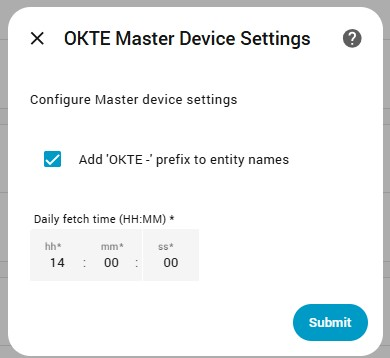

#### 🔢 Calculator Devices
- Add **unlimited number** of Calculator devices
- Each Calculator device is **independently configured**
- Automatically numbered: Calculator 1, Calculator 2, Calculator 3, etc.
- Uses data from OKTE Master to find optimal price windows
- Perfect for different automation scenarios (battery charging, heat pump operation, etc.)

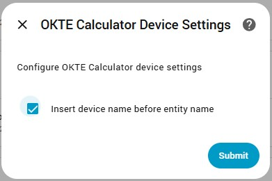

#### Adding Devices

1. Go to **Settings** → **Devices & Services**
2. Click **+ Add Integration**
3. Search for **"OKTE"**
4. Select device type:
   - **Master (API Data Fetcher)** - if this is your first installation
   - **Calculator (Time Window Calculator)** - for additional calculator devices

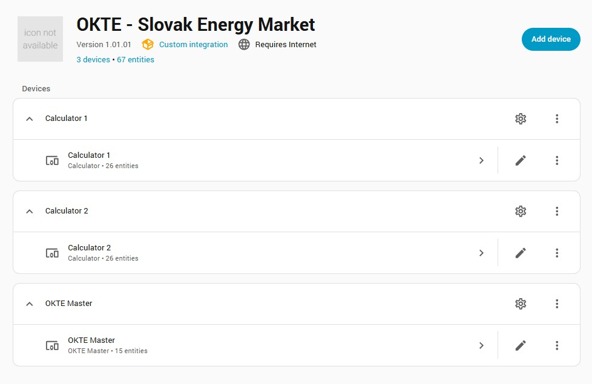

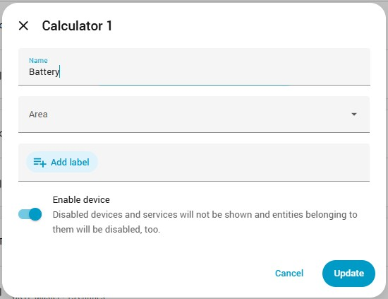

#### Entity Name Configuration

Both device types offer an option to **include device name in entity names**:

**OKTE Master:**
- ✅ **Enabled** (default): `sensor.okte_current_price`
- ⬜ **Disabled**: `sensor.current_price`

**Calculator Devices:**
- ✅ **Enabled** (default): `sensor.okte_1_lowest_price_window`
- ⬜ **Disabled**: `sensor.lowest_price_window`

> 💡 **Tip:** Keep this enabled when using multiple Calculator devices to easily distinguish between them!

---

## 📡 OKTE Master Device

The **OKTE Master** device is the core component that handles all communication with the OKTE API. It automatically downloads electricity price data and provides it to the system.

### Master Device Configuration


#### Configuration Parameters

| Parameter | Default | Description |
|-----------|---------|-------------|
| **Add 'OKTE -' prefix to entity names** | ✅ Enabled | Adds "okte_" prefix to all entity IDs |
| **Daily fetch time** | 14:00 | Time when data is automatically downloaded from OKTE API |

> ⚠️ **Important:** OKTE publishes next day prices around **13:00**, so the default fetch time of **14:00** ensures you always have up-to-date data for both days. Data is also automatically downloaded at 10, 60 and 120 seconds after midnight to update the data for the current day, but since in OKTE the data for the next day is only available after 13:00, with this midnight download only the current day is loaded, the next day only with the next download (default 14:00). In case of unsuccessful data download, for example due to an interrupted internet connection or a malfunction on the OKTE side, the integration will try to download the data every minute until it is successfully downloaded. This status is indicated by the sensor.okte_connection_status sensor and the error code is recorded in the sensor.okte_error_code sensor.

### Master Device Entities

The Master device creates the following entities:

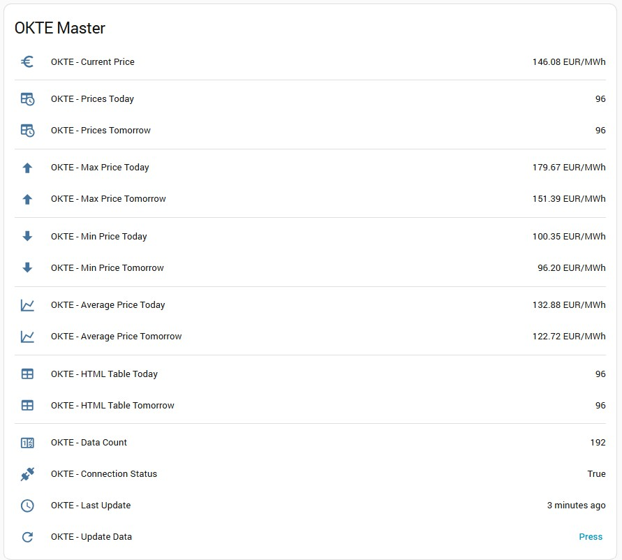

#### 📊 Price Sensors

| Entity ID | Description | Unit | Attributes |
|-----------|-------------|------|------------|
| `sensor.okte_current_price` | Current electricity price | EUR/MWh | - |
| `sensor.okte_average_price_today` | Today's average price | EUR/MWh | - |
| `sensor.okte_min_price_today` | Today's minimum price | EUR/MWh | `time_from`, `time_to` |
| `sensor.okte_max_price_today` | Today's maximum price | EUR/MWh | `time_from`, `time_to` |
| `sensor.okte_average_price_tomorrow` | Tomorrow's average price | EUR/MWh | - |
| `sensor.okte_min_price_tomorrow` | Tomorrow's minimum price | EUR/MWh | `time_from`, `time_to` |
| `sensor.okte_max_price_tomorrow` | Tomorrow's maximum price | EUR/MWh | `time_from`, `time_to` |

#### 📈 Chart Data Sensors

| Entity ID | Description | Purpose |
|-----------|-------------|---------|
| `sensor.okte_prices_today` | Today's prices | **For ApexCharts graphs** |
| `sensor.okte_prices_tomorrow` | Tomorrow's prices | **For ApexCharts graphs** |

**Attributes:**
- `period_data`: Array of objects containing:
  - `time`: ISO timestamp
  - `price`: Price value in EUR/MWh
  - `period`: period of the day

#### 📋 HTML Table Sensors

| Entity ID | Description | Purpose |
|-----------|-------------|---------|
| `sensor.okte_html_table_today` | Today's price table in HTML | **For HTML template cards** |
| `sensor.okte_html_table_tomorrow` | Tomorrow's price table in HTML | **For HTML template cards** |

**Attributes:**
- `html_table`: Complete HTML table code with:
  - Periodical breakdown (00:00 - 23:59)
  - Color-coded prices (green=low, yellow=medium, red=high)
  - Formatted prices with 2 decimal places

#### 🔧 Diagnostic Sensors

| Entity ID | Description | Values |
|-----------|-------------|--------|
| `sensor.okte_connection_status` | API connection status | `Connected` / `Disconnected` |
| `sensor.okte_last_update` | Last successful data fetch | Timestamp |
| `sensor.okte_data_count` | Number of price records | Integer |

#### 🔘 Control Buttons

| Entity ID | Description | Action |
|-----------|-------------|--------|
| `button.okte_update_data` | Manual data fetch | Triggers immediate API data download |

### Example Card for Master Device

```yaml
type: grid
cards:
  - type: entities
    entities:
      - entity: sensor.okte_current_price
      - type: divider
      - entity: sensor.okte_prices_today
      - entity: sensor.okte_prices_tomorrow
      - type: divider
      - entity: sensor.okte_max_price_today
      - entity: sensor.okte_max_price_tomorrow
      - type: divider
      - entity: sensor.okte_min_price_today
      - entity: sensor.okte_min_price_tomorrow
      - type: divider
      - entity: sensor.okte_average_price_today
      - entity: sensor.okte_average_price_tomorrow
      - type: divider
      - entity: sensor.okte_html_table_today
      - entity: sensor.okte_html_table_tomorrow
      - type: divider
      - entity: sensor.okte_error_code sensor
      - entity: sensor.okte_data_count
      - entity: sensor.okte_connection_status
      - entity: sensor.okte_last_update
      - entity: button.okte_update_data
    title: OKTE Master
    grid_options:
      columns: full
column_span: 2
```

---

## 🔢 Calculator Device

The **Calculator** device uses data from the OKTE Master to find optimal time windows with the lowest or highest electricity prices. You can add **unlimited** Calculator devices, each with independent configuration for different automation scenarios.

### Calculator Device Configuration


#### Configuration Parameters

| Parameter | Default | Description |
|-----------|---------|-------------|
| **Insert device name before entity name** | ✅ Enabled | Adds device identifier to entity names |
| **Window size** | 3 hours | Default size for price window calculations |
| **Time range from** | 00:00 | Default start time for window search |
| **Time range to** | 23:59 | Default end time for window search |

### Calculator Device Entities

Each Calculator device creates a comprehensive set of entities for finding and tracking optimal price windows:

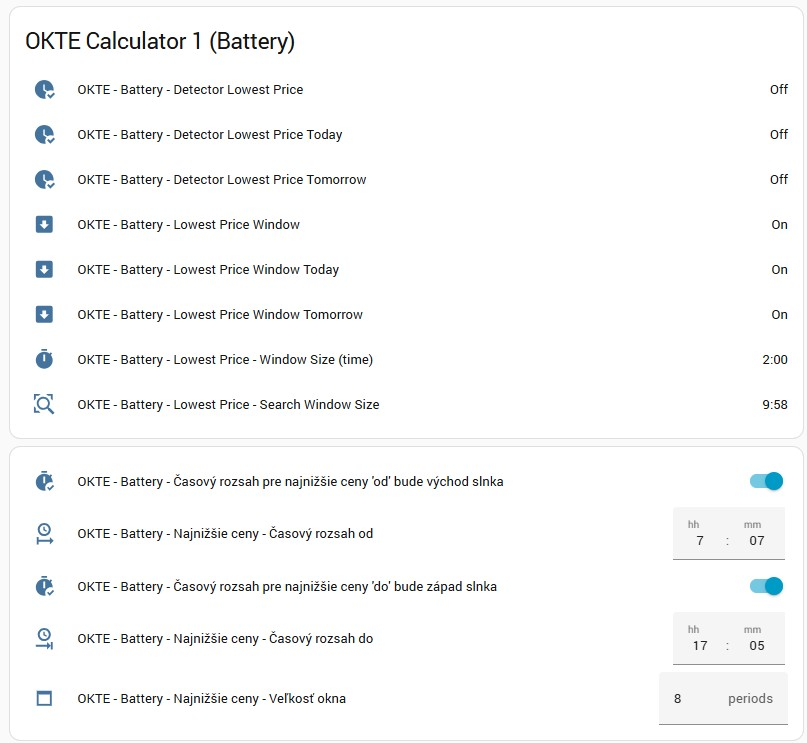

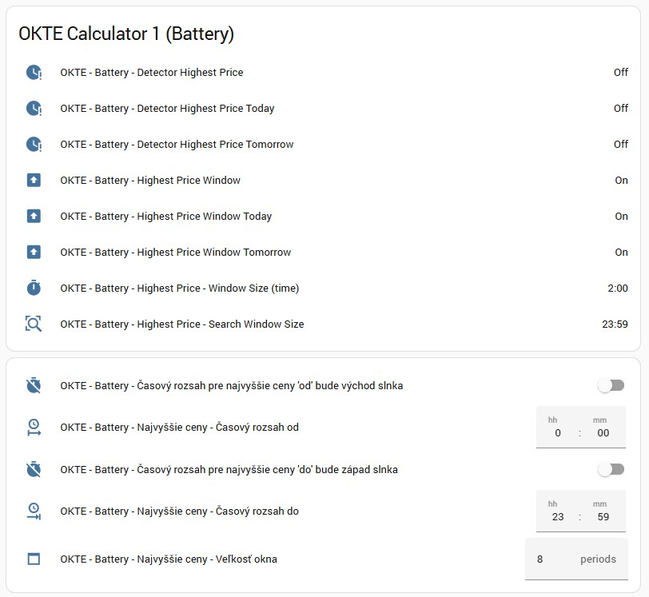

### Entity ID Prefixes

Calculator devices use **numbered prefixes** in entity IDs:

| Device | Entity ID Example | Pattern |
|--------|------------------|---------|
| Calculator 1 | `sensor.okte_1_lowest_price_window` | `okte_1_{entity_name}` |
| Calculator 2 | `sensor.okte_2_lowest_price_window` | `okte_2_{entity_name}` |
| Calculator 3 | `sensor.okte_3_lowest_price_window` | `okte_3_{entity_name}` |

> 💡 **Note:** The number automatically increments for each new Calculator device

#### 📊 Lowest Price Window Sensors

| Entity ID Pattern | Description | Attributes |
|-------------------|-------------|------------|
| `sensor.okte_N_lowest_price_window` | Combined lowest price window (today or tomorrow) | `start_time`, `end_time`, `average_price`, `min_price`, `max_price`, `prices` |
| `sensor.okte_N_lowest_price_window_today` | Today's lowest price window | `start_time`, `end_time`, `average_price`, `min_price`, `max_price`, `prices` |
| `sensor.okte_N_lowest_price_window_tomorrow` | Tomorrow's lowest price window | `start_time`, `end_time`, `average_price`, `min_price`, `max_price`, `prices` |
| `sensor.okte_N_lowest_price_window_size` | Window duration in H:MM format | - |
| `sensor.okte_N_lowest_price_search_window_size` | Search window duration in H:MM format | - |

#### 📊 Highest Price Window Sensors

| Entity ID Pattern | Description | Attributes |
|-------------------|-------------|------------|
| `sensor.okte_N_highest_price_window` | Combined highest price window (today or tomorrow) | `start_time`, `end_time`, `average_price`, `min_price`, `max_price`, `prices` |
| `sensor.okte_N_highest_price_window_today` | Today's highest price window | `start_time`, `end_time`, `average_price`, `min_price`, `max_price`, `prices` |
| `sensor.okte_N_highest_price_window_tomorrow` | Tomorrow's highest price window | `start_time`, `end_time`, `average_price`, `min_price`, `max_price`, `prices` |
| `sensor.okte_N_highest_price_window_size` | Window duration in H:MM format | - |
| `sensor.okte_N_highest_price_search_window_size` | Search window duration in H:MM format | - |

#### 🎯 Binary Sensor Detectors

These detectors automatically turn **ON** when the current time is within the calculated price window:

**Lowest Price Detectors:**
| Entity ID Pattern | Description | States |
|-------------------|-------------|--------|
| `binary_sensor.okte_N_detector_lowest_price` | ON when in lowest price window (combined) | ON / OFF |
| `binary_sensor.okte_N_detector_lowest_price_today` | ON when in today's lowest price window | ON / OFF |
| `binary_sensor.okte_N_detector_lowest_price_tomorrow` | ON when in tomorrow's lowest price window | ON / OFF |

**Highest Price Detectors:**
| Entity ID Pattern | Description | States |
|-------------------|-------------|--------|
| `binary_sensor.okte_N_detector_highest_price` | ON when in highest price window (combined) | ON / OFF |
| `binary_sensor.okte_N_detector_highest_price_today` | ON when in today's highest price window | ON / OFF |
| `binary_sensor.okte_N_detector_highest_price_tomorrow` | ON when in tomorrow's highest price window | ON / OFF |

> 💡 **Use Case:** Perfect for automation triggers! Turn on battery charging when detector is ON, or reduce consumption during high price periods.

#### ⚙️ Control Entities - Lowest Price Window

**Time Range Configuration:**
| Entity ID Pattern | Type | Description | Default |
|-------------------|------|-------------|---------|
| `switch.okte_N_lowest_price_window_from_as_day_start` | Switch | Auto-set start time to sunrise | OFF |
| `time.okte_N_lowest_price_time_from` | Time | Manual start time | 00:00 |
| `switch.okte_N_lowest_price_window_to_as_day_end` | Switch | Auto-set end time to sunset | OFF |
| `time.okte_N_lowest_price_time_to` | Time | Manual end time | 23:59 |
| `number.okte_N_lowest_price_window_size` | Number | Price window duration (hours) | 3 |

**How Sunrise/Sunset Switches Work:**
- ✅ **ON**: Time is automatically set to sunrise/sunset
- ⬜ **OFF**: Manual time from `time` entity is used

> 🌅 **Example:** Enable sunrise switch to automatically search for lowest prices starting from sunrise each day

#### ⚙️ Control Entities - Highest Price Window

**Time Range Configuration:**
| Entity ID Pattern | Type | Description | Default |
|-------------------|------|-------------|---------|
| `switch.okte_N_highest_price_window_from_as_day_start` | Switch | Auto-set start time to sunrise | OFF |
| `time.okte_N_highest_price_time_from` | Time | Manual start time | 00:00 |
| `switch.okte_N_highest_price_window_to_as_day_end` | Switch | Auto-set end time to sunset | OFF |
| `time.okte_N_highest_price_time_to` | Time | Manual end time | 23:59 |
| `number.okte_N_highest_price_window_size` | Number | Price window duration (hours) | 3 |

### Example Card for Calculator Device

```yaml
type: grid
cards:
  # Lowest Price Window Information
  - type: entities
    entities:
      - entity: binary_sensor.okte_1_detector_lowest_price
      - entity: binary_sensor.okte_1_detector_lowest_price_today
      - entity: binary_sensor.okte_1_detector_lowest_price_tomorrow
      - entity: sensor.okte_1_lowest_price_window
      - entity: sensor.okte_1_lowest_price_window_today
      - entity: sensor.okte_1_lowest_price_window_tomorrow
      - entity: sensor.okte_1_lowest_price_window_size
      - entity: sensor.okte_1_lowest_price_search_window_size
    title: OKTE Calculator 1 - Lowest Prices
    grid_options:
      columns: full
      rows: auto
  
  # Lowest Price Window Controls
  - type: entities
    entities:
      - entity: switch.okte_1_lowest_price_window_from_as_day_start
      - entity: time.okte_1_lowest_price_time_from
      - entity: switch.okte_1_lowest_price_window_to_as_day_end
      - entity: time.okte_1_lowest_price_time_to
      - entity: number.okte_1_lowest_price_window_size
    title: Lowest Price - Settings
    grid_options:
      columns: full
      rows: auto
  
  # Highest Price Window Information
  - type: entities
    entities:
      - entity: binary_sensor.okte_1_detector_highest_price
      - entity: binary_sensor.okte_1_detector_highest_price_today
      - entity: binary_sensor.okte_1_detector_highest_price_tomorrow
      - entity: sensor.okte_1_highest_price_window
      - entity: sensor.okte_1_highest_price_window_today
      - entity: sensor.okte_1_highest_price_window_tomorrow
      - entity: sensor.okte_1_highest_price_window_size
      - entity: sensor.okte_1_highest_price_search_window_size
    title: OKTE Calculator 1 - Highest Prices
    grid_options:
      columns: full
      rows: auto
  
  # Highest Price Window Controls
  - type: entities
    entities:
      - entity: switch.okte_1_highest_price_window_from_as_day_start
      - entity: time.okte_1_highest_price_time_from
      - entity: switch.okte_1_highest_price_window_to_as_day_end
      - entity: time.okte_1_highest_price_time_to
      - entity: number.okte_1_highest_price_window_size
    title: Highest Price - Settings
    grid_options:
      columns: full
      rows: auto
column_span: 2
```

---

## 💾 Database Optimization

The OKTE integration includes sensors with **large data volumes** (HTML tables, price arrays) that can significantly increase your Home Assistant database size. These entities are fully functional and visible in the UI but should be **excluded from the recorder** to prevent database performance issues.

### Recommended Exclusions

Add the following configuration to your `configuration.yaml`:

```yaml
recorder:
  exclude:
    entities:
      - sensor.okte_prices_today
      - sensor.okte_prices_tomorrow
      - sensor.okte_html_table_today
      - sensor.okte_html_table_tomorrow
```

> ⚠️ **After adding this configuration, restart Home Assistant to apply the changes.**

### Why Exclude These Entities?

| Entity | Data Size | Reason |
|--------|-----------|--------|
| `sensor.okte_prices_today` | ~16 KB | Contains 24-48 hours of detailed price data |
| `sensor.okte_prices_tomorrow` | ~16 KB | Contains 24-48 hours of detailed price data |
| `sensor.okte_html_table_today` | ~8 KB | Full HTML table with styling |
| `sensor.okte_html_table_tomorrow` | ~8 KB | Full HTML table with styling |

### Configuration Warning

After installation, the integration will display a **system notification** recommending these exclusions:

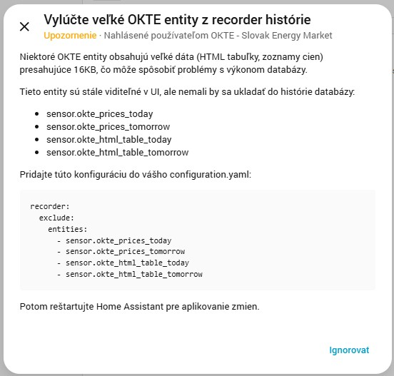

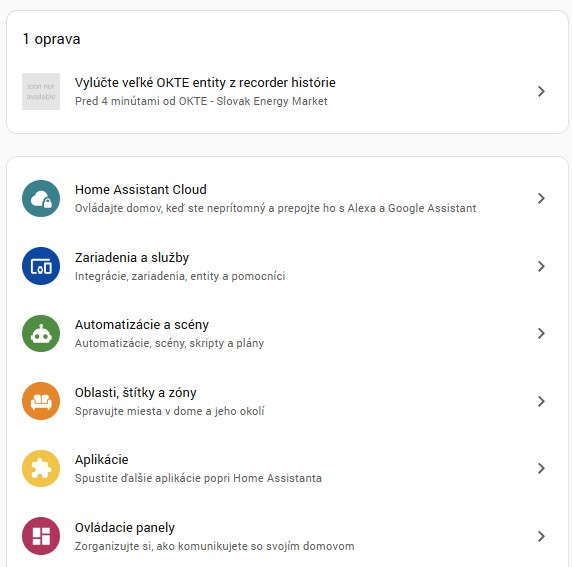

> 💡 **Note:** These entities will still work perfectly in your dashboards and automations - they just won't be stored in historical database records.

---

## 📈 Price Charts

The OKTE integration provides price data perfectly formatted for **ApexCharts Card** visualization. This allows you to create beautiful, interactive price charts.

### Prerequisites

Install the **ApexCharts Card** via HACS:
1. Open HACS → Frontend
2. Search for "ApexCharts Card"
3. Install and restart Home Assistant

### Chart Examples

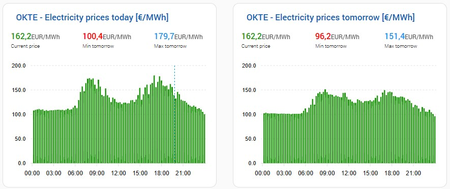

#### Today's Prices Chart

```yaml
type: custom:apexcharts-card
grid_options:
  columns: 12
  rows: auto
card_mod:
  style: |
    ha-card {
      min-width: 400px;
      padding: 0px 10px 0px 0px;
    }
    ha-card div#header__title {
      font-size: 17px !important;
      color:#1a60b2;
      padding: 5px 0px 10px 10px;
    }
apex_config:
  chart:
    zoom:
      autoScaleYaxis: false
  plotOptions:
    bar:
      columnWidth: 70%
graph_span: 24h
span:
  start: day
header:
  show: true
  title: OKTE - Electricity prices today [€/MWh]
  show_states: true
  colorize_states: true
now:
  show: true
experimental:
  color_threshold: true
series:
  - entity: sensor.okte_prices_today
    name: Price €/MWh
    type: column
    color_threshold:
      - value: 0
        color: red
      - value: 0
        color: "#FFAA10"
      - value: 20
        color: "#219610"
      - value: 300
        color: "#2196F0"
    stroke_width: 0
    color: "#219610"
    data_generator: |
      const data = entity.attributes.period_data || [];
      return data
        .slice(0,96)
        .map((entry) => {
          return [new Date(entry.time).getTime(), entry.price];
        });
    show:
      extremas: false
      in_header: false
  - entity: sensor.okte_current_price
    name: Current price
    color: "#219610"
    data_generator: |
      const now = new Date();
      const currentValue = parseFloat(entity.state);
      return [[now.getTime(), currentValue]];
    show:
      in_chart: false
      in_header: true
  - entity: sensor.okte_min_price_today
    name: Min today
    color: red
    data_generator: |
      const now = new Date();
      const minValue = parseFloat(entity.state);
      return [[now.getTime(), minValue]];
    show:
      in_chart: false
      in_header: true
  - entity: sensor.okte_max_price_today
    name: Max today
    color: "#2196F0"
    data_generator: |
      const now = new Date();
      const maxValue = parseFloat(entity.state);
      return [[now.getTime(), maxValue]];
    show:
      in_chart: false
      in_header: true
```

#### Tomorrow's Prices Chart

```yaml
type: custom:apexcharts-card
grid_options:
  columns: 12
  rows: auto
card_mod:
  style: |
    ha-card {
      min-width: 400px;
      padding: 0px 10px 0px 0px;
    }
    ha-card div#header__title {
      font-size: 17px !important;
      color:#1a60b2;
      padding: 5px 0px 10px 10px;
    }
apex_config:
  chart:
    zoom:
      autoScaleYaxis: false
  plotOptions:
    bar:
      columnWidth: 70%
graph_span: 24h
span:
  start: day
  offset: +1d
header:
  show: true
  title: OKTE - Electricity prices tomorrow [€/MWh]
  show_states: true
  colorize_states: true
now:
  show: false
experimental:
  color_threshold: true
series:
  - entity: sensor.okte_prices_tomorrow
    name: Price €/MWh
    type: column
    color_threshold:
      - value: 0
        color: red
      - value: 0
        color: "#FFAA10"
      - value: 20
        color: "#219610"
      - value: 300
        color: "#2196F0"
    stroke_width: 0
    color: "#219610"
    data_generator: |
      const data = entity.attributes.period_data || [];
      return data
        .slice(0,96)
        .map((entry) => {
          return [new Date(entry.time).getTime(), entry.price];
        });
    show:
      extremas: false
      in_header: false
  - entity: sensor.okte_min_price_tomorrow
    name: Min tomorrow
    color: red
    data_generator: |
      const now = new Date();
      const minValue = parseFloat(entity.state);
      return [[now.getTime(), minValue]];
    show:
      in_chart: false
      in_header: true
  - entity: sensor.okte_max_price_tomorrow
    name: Max tomorrow
    color: "#2196F0"
    data_generator: |
      const now = new Date();
      const maxValue = parseFloat(entity.state);
      return [[now.getTime(), maxValue]];
    show:
      in_chart: false
      in_header: true
```

### Chart Features

- 📊 **Color-coded bars** based on price ranges
- 🎯 **Current time indicator** (today's chart)
- 📈 **Min/Max/Current prices** in header
- 🖱️ **Interactive zoom** and hover tooltips
- 📱 **Responsive design** for mobile devices

---

## 📋 HTML Price Tables

The OKTE integration generates fully formatted **HTML tables** with color-coded prices for easy visualization.

### Prerequisites

Install the **HTML Template Card** via HACS:
1. Open HACS → Frontend
2. Search for "HTML Template Card"
3. Install and restart Home Assistant

### Table Examples

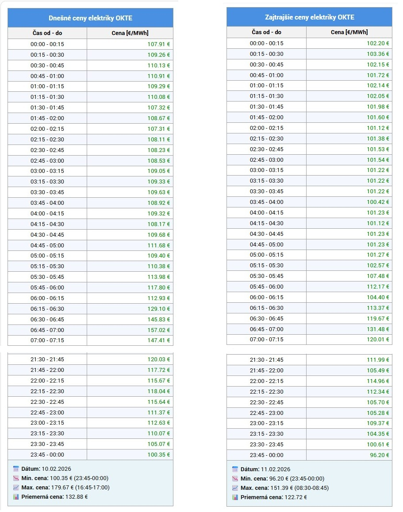

#### Today's Price Table

```yaml
type: custom:html-template-card
content: >-
  
  
  
  
  <table border="1" cellpadding="5" cellspacing="0" style="border-collapse: collapse; width: 100%; max-width: 400px; border-color: color-mix(in srgb, var(--primary-text-color, #000000) 35%, transparent); color: var(--primary-text-color, #000000);">
  <thead>
  <tr style="background-color: var(--primary-color, #4a90e2); color: var(--text-primary-color, #ffffff);"><th colspan="2" style="text-align: center; font-size: 16px; padding: 10px;">Dnešné ceny elektriky OKTE</th></tr>
  <tr style="background-color: var(--secondary-background-color, #f2f2f2); color: var(--primary-text-color, #000000);"><th style="text-align: center; padding: 2px 7px;">Čas od - do</th><th style="text-align: center; padding: 2px 7px;">Cena [€/MWh]</th></tr>
  </thead>
  <tbody>
  
  <tr><td colspan="2" style="text-align: center; height: 200px; vertical-align: middle;">Údaje nie sú k dispozícii</td></tr>
  
  
  <tr style="background-color: {{ 'var(--card-background-color, #ffffff)' if loop.index0 % 2 == 0 else 'color-mix(in srgb, var(--primary-text-color, #000000) 6%, var(--card-background-color, #ffffff))' }};"><td style="text-align: center; padding: 1px 7px;">{{ p.period_start }} - {{ p.period_end }}</td><td style="text-align: right; color: {{ 'light-dark(#009000, #5fd35f)' if p.price > 20 else ('light-dark(#d08000, #ffb74d)' if p.price >= 0 else 'light-dark(#d00000, #ff6b6b)') }}; padding: 1px 7px;">{{ '%.2f' | format(p.price) }} €</td></tr>
  
  
  </tbody>
  
  
  
  
  <tfoot>
  <tr style="background-color: color-mix(in srgb, var(--primary-color, #4a90e2) 12%, var(--card-background-color, #ffffff));"><td colspan="2" style="padding: 10px; font-size: 14px;">
  <strong>📅 Dátum:</strong> {{ dr[2] }}.{{ dr[1] }}.{{ dr[0] }}<br>
  <strong>📉 Min. cena:</strong> {{ '%.2f' | format(mnp) }} € ({{ mn.period_start }}-{{ mn.period_end }})<br>
  <strong>📈 Max. cena:</strong> {{ '%.2f' | format(mxp) }} € ({{ mx.period_start }}-{{ mx.period_end }})<br>
  <strong>📊 Priemerná cena:</strong> {{ '%.2f' | format(state_attr('sensor.okte_prices_today', 'avg_price')) }} €
  </td></tr>
  </tfoot>
  
  </table>
  {{ out | replace('\n', '') | trim }}
```

#### Tomorrow's Price Table

```yaml
type: custom:html-template-card
content: >-
  
  
  
  
  <table border="1" cellpadding="5" cellspacing="0" style="border-collapse: collapse; width: 100%; max-width: 400px; border-color: color-mix(in srgb, var(--primary-text-color, #000000) 35%, transparent); color: var(--primary-text-color, #000000);">
  <thead>
  <tr style="background-color: var(--primary-color, #4a90e2); color: var(--text-primary-color, #ffffff);"><th colspan="2" style="text-align: center; font-size: 16px; padding: 10px;">Zajtrajšie ceny elektriky OKTE</th></tr>
  <tr style="background-color: var(--secondary-background-color, #f2f2f2); color: var(--primary-text-color, #000000);"><th style="text-align: center; padding: 2px 7px;">Čas od - do</th><th style="text-align: center; padding: 2px 7px;">Cena [€/MWh]</th></tr>
  </thead>
  <tbody>
  
  <tr><td colspan="2" style="text-align: center; height: 200px; vertical-align: middle;">Údaje nie sú k dispozícii</td></tr>
  
  
  <tr style="background-color: {{ 'var(--card-background-color, #ffffff)' if loop.index0 % 2 == 0 else 'color-mix(in srgb, var(--primary-text-color, #000000) 6%, var(--card-background-color, #ffffff))' }};"><td style="text-align: center; padding: 1px 7px;">{{ p.period_start }} - {{ p.period_end }}</td><td style="text-align: right; color: {{ 'light-dark(#009000, #5fd35f)' if p.price > 20 else ('light-dark(#d08000, #ffb74d)' if p.price >= 0 else 'light-dark(#d00000, #ff6b6b)') }}; padding: 1px 7px;">{{ '%.2f' | format(p.price) }} €</td></tr>
  
  
  </tbody>
  
  
  
  
  <tfoot>
  <tr style="background-color: color-mix(in srgb, var(--primary-color, #4a90e2) 12%, var(--card-background-color, #ffffff));"><td colspan="2" style="padding: 10px; font-size: 14px;">
  <strong>📅 Dátum:</strong> {{ dr[2] }}.{{ dr[1] }}.{{ dr[0] }}<br>
  <strong>📉 Min. cena:</strong> {{ '%.2f' | format(mnp) }} € ({{ mn.period_start }}-{{ mn.period_end }})<br>
  <strong>📈 Max. cena:</strong> {{ '%.2f' | format(mxp) }} € ({{ mx.period_start }}-{{ mx.period_end }})<br>
  <strong>📊 Priemerná cena:</strong> {{ '%.2f' | format(state_attr('sensor.okte_prices_tomorrow', 'avg_price')) }} €
  </td></tr>
  </tfoot>
  
  </table>
  {{ out | replace('\n', '') | trim }}
```

### Table Features

- 🎨 **Color-coded prices**:
  - 🟢 **Green**: Low prices (good for energy consumption)
  - 🟡 **Yellow**: Medium prices
  - 🔴 **Red**: High prices (reduce consumption)
- 🕐 **Periodical breakdown** from 00:00 to 23:59
- 💰 **Formatted prices** with 2 decimal places
- 📱 **Responsive design** adapts to screen size

---

## 🤖 Automation Examples

The OKTE integration provides powerful tools for creating smart energy automations based on electricity prices.

### Example 1: Battery Charging During Lowest Prices

Automatically charge your battery when electricity prices are at their lowest:

```yaml
automation:
  - alias: "Battery - Charge During Lowest Price Window"
    description: "Charge battery when in lowest price window"
    trigger:
      - platform: state
        entity_id: binary_sensor.okte_1_detector_lowest_price
        to: "on"
    condition:
      - condition: numeric_state
        entity_id: sensor.battery_level
        below: 80
    action:
      - service: switch.turn_on
        target:
          entity_id: switch.battery_charger
      - service: notify.mobile_app
        data:
          title: "⚡ Battery Charging Started"
          message: "Charging during low price period ({{ states('sensor.okte_current_price') }} €/MWh)"
  
  - alias: "Battery - Stop Charging After Lowest Price Window"
    description: "Stop charging when lowest price window ends"
    trigger:
      - platform: state
        entity_id: binary_sensor.okte_1_detector_lowest_price
        to: "off"
    action:
      - service: switch.turn_off
        target:
          entity_id: switch.battery_charger
      - service: notify.mobile_app
        data:
          title: "🔋 Battery Charging Stopped"
          message: "Low price period ended"
```

### Example 2: Heat Pump Operation During Low Prices

Optimize heat pump operation based on electricity prices:

```yaml
automation:
  - alias: "Heat Pump - Boost During Low Prices"
    description: "Increase heat pump power during lowest price window"
    trigger:
      - platform: state
        entity_id: binary_sensor.okte_2_detector_lowest_price
        to: "on"
    condition:
      - condition: numeric_state
        entity_id: sensor.outdoor_temperature
        below: 5
    action:
      - service: climate.set_temperature
        target:
          entity_id: climate.heat_pump
        data:
          temperature: 23
      - service: number.set_value
        target:
          entity_id: number.heat_pump_power_limit
        data:
          value: 100
```

### Example 3: Avoid High Price Periods

Reduce energy consumption during the most expensive periods:

```yaml
automation:
  - alias: "Energy - Reduce Consumption During High Prices"
    description: "Disable non-essential devices during highest price window"
    trigger:
      - platform: state
        entity_id: binary_sensor.okte_3_detector_highest_price
        to: "on"
    action:
      - service: switch.turn_off
        target:
          entity_id:
            - switch.electric_water_heater
            - switch.pool_pump
            - switch.ev_charger
      - service: notify.mobile_app
        data:
          title: "⚠️ High Price Period"
          message: "Non-essential devices disabled ({{ states('sensor.okte_current_price') }} €/MWh)"
```

### Example 4: Dynamic Window Size Adjustment

Automatically adjust the price window size based on battery level:

```yaml
automation:
  - alias: "Battery - Adjust Charging Window Size"
    description: "Increase charging window when battery is very low"
    trigger:
      - platform: numeric_state
        entity_id: sensor.battery_level
        below: 20
    action:
      - service: number.set_value
        target:
          entity_id: number.okte_1_lowest_price_window_size
        data:
          value: 6
  
  - alias: "Battery - Normal Charging Window Size"
    description: "Use normal window size when battery is OK"
    trigger:
      - platform: numeric_state
        entity_id: sensor.battery_level
        above: 50
    action:
      - service: number.set_value
        target:
          entity_id: number.okte_1_lowest_price_window_size
        data:
          value: 3
```

### Example 5: Price Notification

Get notified about tomorrow's lowest price window:

```yaml
automation:
  - alias: "OKTE - Tomorrow's Lowest Price Notification"
    description: "Send notification with tomorrow's cheapest time"
    trigger:
      - platform: time
        at: "14:30:00"
    action:
      - service: notify.mobile_app
        data:
          title: "⚡ Tomorrow's Lowest Price Window"
          message: >
            Lowest prices tomorrow:
            {{ state_attr('sensor.okte_1_lowest_price_window_tomorrow', 'start_time') }} - 
            {{ state_attr('sensor.okte_1_lowest_price_window_tomorrow', 'end_time') }}
            Average: {{ state_attr('sensor.okte_1_lowest_price_window_tomorrow', 'average_price') }} €/MWh
```

### Automation Tips

💡 **Best Practices:**

1. **Use multiple Calculator devices** for different appliances (battery, heat pump, water heater)
2. **Adjust window sizes** based on your needs (3h for battery, 6h for heat pump)
3. **Combine price detectors** with other conditions (temperature, battery level)
4. **Set sunrise/sunset switches** for more natural automation patterns
5. **Use notifications** to stay informed about price changes

---

## 🔧 Troubleshooting

### Integration Not Loading

1. **Check logs** in Settings → System → Logs
2. **Verify installation** - files should be in `custom_components/okte/`
3. **Restart Home Assistant** after installation
4. **Clear browser cache** if UI doesn't show the integration

### No Data / Unavailable Sensors

1. **Check OKTE Master connection**: Verify `sensor.okte_connection_status` is "Connected"
2. **Manually trigger data fetch**: Press `button.okte_update_data`
3. **Verify fetch time**: Ensure it's after 13:00 when OKTE publishes prices
4. **Check API accessibility**: OKTE API might be temporarily unavailable

### Calculator Window Not Updating

1. **Verify time range settings** in Calculator configuration
2. **Check window size** - ensure it's not larger than the search range
3. **Verify OKTE Master** has valid data
4. **Check sunrise/sunset switches** - they might override manual times

### Database Performance Issues

1. **Implement recorder exclusions** as described in [Database Optimization](#-database-optimization)
2. **Restart Home Assistant** after adding exclusions
3. **Purge old data**: Developer Tools → Services → `recorder.purge`

### Charts Not Displaying

1. **Install ApexCharts Card** via HACS
2. **Clear browser cache**
3. **Check entity IDs** in card configuration match your device names
4. **Verify sensor data**: Check if `sensor.okte_prices_today` has `period_data` attribute

---

## 💬 Support

### 📧 Contact & Links

- **GitHub Repository**: [https://github.com/jozef-moravcik-homeassistant/okte](https://github.com/jozef-moravcik-homeassistant/okte)
- **Issues & Bug Reports**: [GitHub Issues](https://github.com/jozef-moravcik-homeassistant/okte/issues)
- **Author**: Jozef Moravcik
- **Email**: jozef.moravcik@moravcik.eu

### 🐛 Reporting Issues

When reporting issues, please include:
1. Home Assistant version
2. OKTE integration version
3. Relevant log entries from Settings → System → Logs
4. Steps to reproduce the issue
5. Screenshots if applicable

### ⭐ Show Your Support

If you find this integration useful, please consider:
- ⭐ **Star the repository** on GitHub
- 🐛 **Report bugs** or suggest features
- 📝 **Share your automation examples** with the community
- ☕ **Buy me a coffee** (donation link in repository)

---

## 📜 License

This project is licensed under the MIT License - see the [LICENSE](LICENSE) file for details.

---

## 🙏 Acknowledgments

- **OKTE** (Operátor krátkodobého trhu s elektrinou) for providing the public API
- **Home Assistant Community** for continuous support and inspiration
- **All Contributors** who helped improve this integration

---

<div align="center">

**[⬆ Back to Top](#-okte---slovak-energy-market-integration-for-home-assistant)**

Made with ❤️ for the Home Assistant community

</div>
