# 🔌 OKTE - Integrácia slovenského trhu s elektrinou pre Home Assistant

[](https://github.com/jozef-moravcik-homeassistant/okte)
[](https://github.com/hacs/integration)
[](LICENSE)

> 📖 **[English version of documentation →](README.md)**

---

## 📋 Úvod

**OKTE Integrácia** je komplexná vlastná integrácia pre Home Assistant, ktorá poskytuje automatické sťahovanie údajov zo slovenského trhu s elektrinou (OKTE - Operátor krátkodobého trhu s elektrinou). Táto integrácia umožňuje inteligentnú automatizáciu domácnosti založenú na aktuálnych cenách elektriny, čím vám pomáha optimalizovať náklady na energiu plánovaním prevádzky energeticky náročných zariadení počas najlacnejších časových okien.

### ✨ Kľúčové funkcie

- 🔄 **Automatická synchronizácia údajov** z OKTE API
- 📊 **Komplexné cenové senzory** pre dnešok a zajtra
- 🕐 **Flexibilné výpočty časových okien** pre vyhľadanie najnižších a najvyšších cenových období
- 📈 **Interaktívne cenové grafy** s podporou ApexCharts
- 📋 **HTML tabuľky** pre jednoduché zobrazenie cien
- 🎯 **Binárne detektory** pre spúšťanie automatizácií
- ⚡ **Sledovanie aktuálnej ceny** v reálnom čase
- 🔢 **Štatistické senzory** (min, max, priemerné ceny)
- 🌓 **Integrácia východu/západu slnka** pre konfiguráciu časových okien
- 🔧 **Viacero Calculator zariadení** pre nezávislé automatizačné scenáre

---

## 📑 Obsah

1. [Inštalácia](#-inštalácia)
   - [Cez HACS](#cez-hacs-odporúčané)
   - [Manuálna inštalácia](#manuálna-inštalácia)
   - [Konfigurácia zariadení](#konfigurácia-zariadení)
2. [OKTE Master zariadenie](#-okte-master-zariadenie)
   - [Konfigurácia Master zariadenia](#konfigurácia-master-zariadenia)
   - [Entity Master zariadenia](#entity-master-zariadenia)
3. [Calculator zariadenie](#-calculator-zariadenie)
   - [Konfigurácia Calculator zariadenia](#konfigurácia-calculator-zariadenia)
   - [Entity Calculator zariadenia](#entity-calculator-zariadenia)
   - [Prefixy ID entít](#prefixy-id-entít)
4. [Optimalizácia databázy](#-optimalizácia-databázy)
5. [Cenové grafy](#-cenové-grafy)
6. [HTML tabuľky cien](#-html-tabuľky-cien)
7. [Príklady automatizácií](#-príklady-automatizácií)
8. [Riešenie problémov](#-riešenie-problémov)
9. [Podpora](#-podpora)

---

## 🔧 Inštalácia

### Cez HACS (Odporúčané)

1. Otvorte **HACS** vo vašom Home Assistant
2. Prejdite do **Integrácie**
3. Kliknite na menu **3 bodky** v pravom hornom rohu
4. Vyberte **Vlastné repozitáre**
5. Pridajte URL repozitára: `https://github.com/jozef-moravcik-homeassistant/okte`
6. Kategória: **Integrácia**
7. Kliknite na **Stiahnuť**
8. Reštartujte Home Assistant

### Manuálna inštalácia

1. Stiahnite najnovšiu verziu z [GitHub](https://github.com/jozef-moravcik-homeassistant/okte)
2. Rozbaľte priečinok `okte` do vášho adresára `custom_components`:
   ```
   config/
   └── custom_components/
       └── okte/
           ├── __init__.py
           ├── manifest.json
           ├── config_flow.py
           └── ...
   ```
3. Reštartujte Home Assistant

### Konfigurácia zariadení

OKTE integrácia používa **dva typy virtuálnych zariadení**:

#### 🎯 OKTE Master zariadenie
- **Automaticky sa nainštaluje ako prvé** počas úvodného nastavenia
- **Len JEDNO Master zariadenie** je povolené na jednu inštanciu Home Assistant
- Zabezpečuje automatické sťahovanie údajov z OKTE API
- Poskytuje cenové senzory, štatistiky a údaje pre Calculator zariadenia
- **Predvolený čas sťahovania údajov: 14:00** (OKTE zverejňuje ceny na zajtra okolo 13:00)

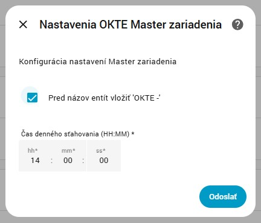

#### 🔢 Calculator zariadenia
- Pridajte **neobmedzený počet** Calculator zariadení
- Každé Calculator zariadenie je **nezávisle nastaviteľné**
- Automaticky číslované: Calculator 1, Calculator 2, Calculator 3, atď.
- Využíva údaje z OKTE Master na vyhľadanie optimálnych cenových okien
- Ideálne pre rôzne automatizačné scenáre (nabíjanie batérie, prevádzka tepelného čerpadla, atď.)

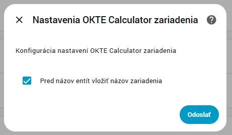

#### Pridanie zariadení

1. Prejdite do **Nastavenia** → **Zariadenia a služby**
2. Kliknite na **+ Pridať integráciu**
3. Vyhľadajte **"OKTE"**
4. Vyberte typ zariadenia:
   - **Master (API Data Fetcher)** - ak je toto vaša prvá inštalácia
   - **Calculator (Time Window Calculator)** - pre ďalšie calculator zariadenia

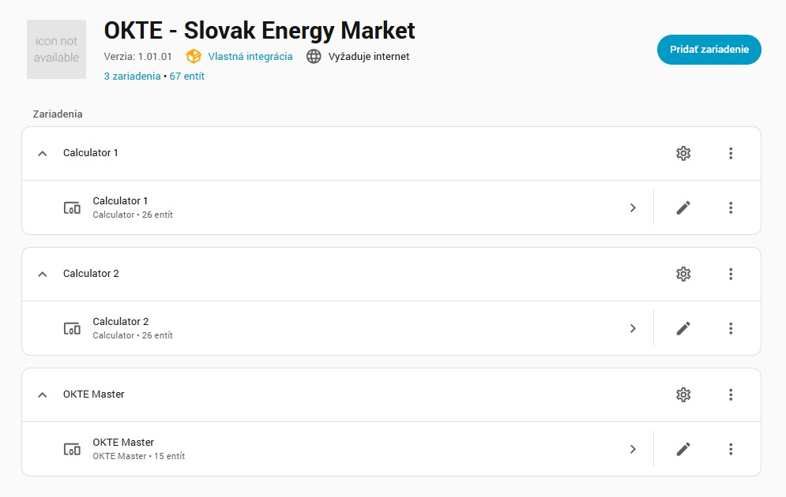

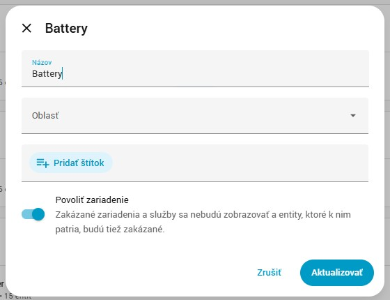

#### Konfigurácia názvov entít

Oba typy zariadení ponúkajú možnosť **zahrnúť názov zariadenia do názvov entít**:

**OKTE Master:**
- ✅ **Zapnuté** (predvolené): `sensor.okte_current_price`
- ⬜ **Vypnuté**: `sensor.current_price`

**Calculator zariadenia:**
- ✅ **Zapnuté** (predvolené): `sensor.okte_1_lowest_price_window`
- ⬜ **Vypnuté**: `sensor.lowest_price_window`

> 💡 **Tip:** Nechajte zapnuté pri používaní viacerých Calculator zariadení, aby ste ich ľahko rozlíšili!

---

## 📡 OKTE Master zariadenie

**OKTE Master** zariadenie je jadro komponenty, ktorá zabezpečuje celú komunikáciu s OKTE API. Automaticky sťahuje údaje o cenách elektriny a poskytuje ich systému.

### Konfigurácia Master zariadenia


#### Parametre konfigurácie

| Parameter | Predvolená hodnota | Popis |
|-----------|-------------------|-------|
| **Pridať prefix 'OKTE -' k názvom entít** | ✅ Zapnuté | Pridá prefix "okte_" ku všetkým ID entít |
| **Denný čas sťahovania** | 14:00 | Čas, kedy sa automaticky sťahujú údaje z OKTE API |

> ⚠️ **Dôležité:** OKTE zverejňuje ceny na zajtra okolo **13:00**, takže predvolený čas sťahovania **14:00** zabezpečuje, že budete mať vždy aktuálne údaje pre oba dni. Údaje sa automaticky sťahujú aj 10, 60 a 120 sekúnd po polnoci, aby boli údaje updatované pre aktuálny deň, ale keďže v OKTE sú údaje na nasledujúci zvedejnené až po 13:00, pri tomto polnočnom sťahovaní sa načíta len aktuálny deň, nasledujúci deň až pri ďalšom  sťahovaní (default 14:00), V prípade neúspešného stiahnutia údajov, napríklad z dôvodu prerušeného pripojenia k internetu, alebo poruchy na strane OKTE, bude sa intergácia pokúšať stiahnuť údaje každú minútu až dokiaľ sa úspešne nestiahnu. Tento stav je indikovaný sensorom sensor.okte_connection_status a chybový kód je zaznamenaný v sensore sensor.okte_error_code.

### Entity Master zariadenia

Master zariadenie vytvára nasledujúce entity:

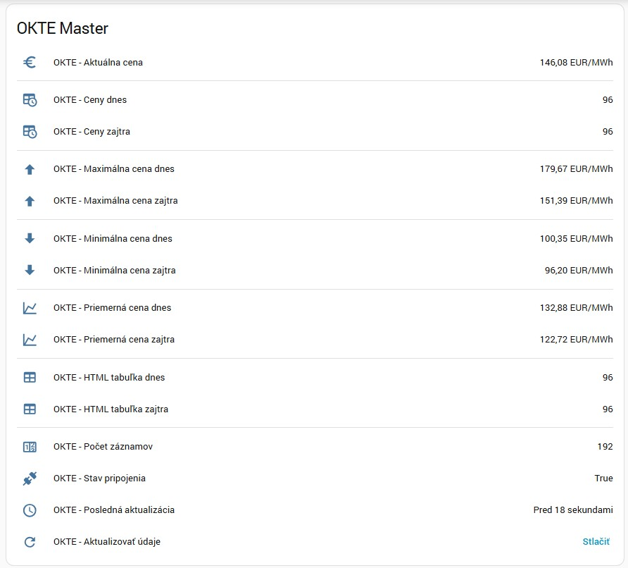

#### 📊 Cenové senzory

| ID entity | Popis | Jednotka | Atribúty |
|-----------|-------|----------|-----------|
| `sensor.okte_current_price` | Aktuálna cena elektriny | EUR/MWh | - |
| `sensor.okte_average_price_today` | Priemerná cena dnes | EUR/MWh | - |
| `sensor.okte_min_price_today` | Minimálna cena dnes | EUR/MWh | `time_from`, `time_to` |
| `sensor.okte_max_price_today` | Maximálna cena dnes | EUR/MWh | `time_from`, `time_to` |
| `sensor.okte_average_price_tomorrow` | Priemerná cena zajtra | EUR/MWh | - |
| `sensor.okte_min_price_tomorrow` | Minimálna cena zajtra | EUR/MWh | `time_from`, `time_to` |
| `sensor.okte_max_price_tomorrow` | Maximálna cena zajtra | EUR/MWh | `time_from`, `time_to` |

#### 📈 Senzory údajov pre grafy

| ID entity | Popis | Účel |
|-----------|-------|------|
| `sensor.okte_prices_today` | Ceny dnes | **Pre ApexCharts grafy** |
| `sensor.okte_prices_tomorrow` | Ceny zajtra | **Pre ApexCharts grafy** |

**Atribúty:**
- `period_data`: Pole objektov obsahujúce:
  - `time`: ISO časová pečiatka
  - `price`: Hodnota ceny v EUR/MWh
  - `period`: Perióda dňa

#### 📋 Senzory HTML tabuliek

| ID entity | Popis | Účel |
|-----------|-------|------|
| `sensor.okte_html_table_today` | Cenová tabuľka dnes v HTML | **Pre HTML template karty** |
| `sensor.okte_html_table_tomorrow` | Cenová tabuľka zajtra v HTML | **Pre HTML template karty** |

**Atribúty:**
- `html_table`: Kompletný HTML kód tabuľky s:
  - Periodickým rozčlenením (00:00 - 23:59)
  - Farebne kódovanými cenami (zelená=nízka, žltá=stredná, červená=vysoká)
  - Formátovanými cenami s 2 desatinnými miestami

#### 🔧 Diagnostické senzory

| ID entity | Popis | Hodnoty |
|-----------|-------|---------|
| `sensor.okte_connection_status` | Stav API pripojenia | `Pripojené` / `Odpojené` |
| `sensor.okte_last_update` | Posledné úspešné stiahnutie údajov | Časová pečiatka |
| `sensor.okte_data_count` | Počet cenových záznamov | Celé číslo |

#### 🔘 Ovládacie tlačidlá

| ID entity | Popis | Akcia |
|-----------|-------|-------|
| `button.okte_update_data` | Manuálne stiahnutie údajov | Spustí okamžité stiahnutie údajov z API |

### Príklad karty pre Master zariadenie

```yaml
type: grid
cards:
  - type: entities
    entities:
      - entity: sensor.okte_current_price
      - type: divider
      - entity: sensor.okte_prices_today
      - entity: sensor.okte_prices_tomorrow
      - type: divider
      - entity: sensor.okte_max_price_today
      - entity: sensor.okte_max_price_tomorrow
      - type: divider
      - entity: sensor.okte_min_price_today
      - entity: sensor.okte_min_price_tomorrow
      - type: divider
      - entity: sensor.okte_average_price_today
      - entity: sensor.okte_average_price_tomorrow
      - type: divider
      - entity: sensor.okte_html_table_today
      - entity: sensor.okte_html_table_tomorrow
      - type: divider
      - entity: sensor.okte_error_code sensor
      - entity: sensor.okte_data_count
      - entity: sensor.okte_connection_status
      - entity: sensor.okte_last_update
      - entity: button.okte_update_data
    title: OKTE Master
    grid_options:
      columns: full
column_span: 2
```

---

## 🔢 Calculator zariadenie

**Calculator** zariadenie využíva údaje z OKTE Master na vyhľadanie optimálnych časových okien s najnižšími alebo najvyššími cenami elektriny. Môžete pridať **neomedzený počet** Calculator zariadení, každé s nezávislou konfiguráciou pre rôzne automatizačné scenáre.

### Konfigurácia Calculator zariadenia


#### Parametre konfigurácie

| Parameter | Predvolená hodnota | Popis |
|-----------|-------------------|-------|
| **Vložiť názov zariadenia pred názov entity** | ✅ Zapnuté | Pridá identifikátor zariadenia do názvov entít |
| **Veľkosť okna** | 3 hodiny | Predvolená veľkosť pre výpočty cenových okien |
| **Časové rozmedzie od** | 00:00 | Predvolený začiatočný čas pre vyhľadávanie okna |
| **Časové rozmedzie do** | 23:59 | Predvolený koncový čas pre vyhľadávanie okna |

### Entity Calculator zariadenia

Každé Calculator zariadenie vytvára komplexný súbor entít pre vyhľadávanie a sledovanie optimálnych cenových okien:

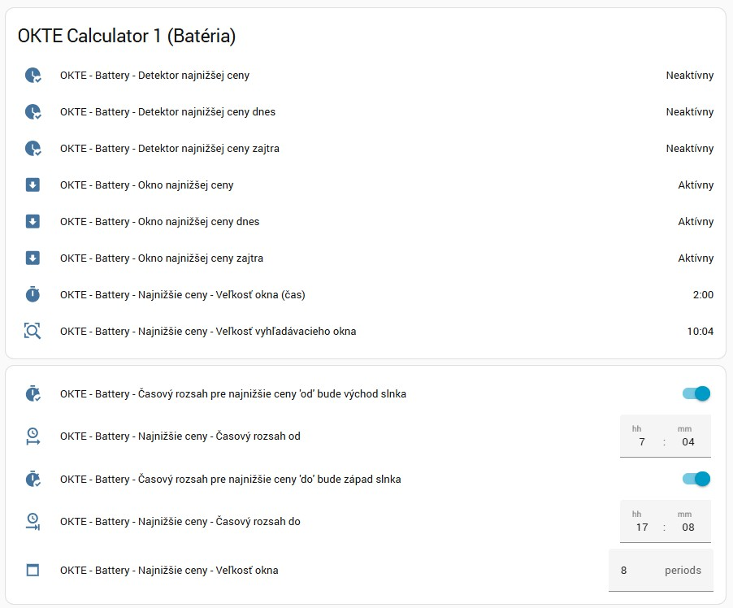

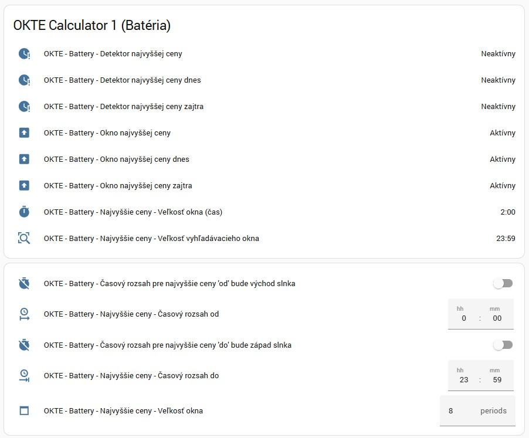

### Prefixy ID entít

Calculator zariadenia používajú **číslované prefixy** v ID entít:

| Zariadenie | Príklad ID entity | Vzor |
|------------|-------------------|------|
| Calculator 1 | `sensor.okte_1_lowest_price_window` | `okte_1_{názov_entity}` |
| Calculator 2 | `sensor.okte_2_lowest_price_window` | `okte_2_{názov_entity}` |
| Calculator 3 | `sensor.okte_3_lowest_price_window` | `okte_3_{názov_entity}` |

> 💡 **Poznámka:** Číslo sa automaticky zvyšuje pre každé nové Calculator zariadenie

#### 📊 Senzory okna najnižšej ceny

| Vzor ID entity | Popis | Atribúty |
|----------------|-------|-----------|
| `sensor.okte_N_lowest_price_window` | Kombinované okno najnižšej ceny (dnes alebo zajtra) | `start_time`, `end_time`, `average_price`, `min_price`, `max_price`, `prices` |
| `sensor.okte_N_lowest_price_window_today` | Okno najnižšej ceny dnes | `start_time`, `end_time`, `average_price`, `min_price`, `max_price`, `prices` |
| `sensor.okte_N_lowest_price_window_tomorrow` | Okno najnižšej ceny zajtra | `start_time`, `end_time`, `average_price`, `min_price`, `max_price`, `prices` |
| `sensor.okte_N_lowest_price_window_size` | Trvanie okna vo formáte H:MM | - |
| `sensor.okte_N_lowest_price_search_window_size` | Trvanie vyhľadávacieho okna vo formáte H:MM | - |

#### 📊 Senzory okna najvyššej ceny

| Vzor ID entity | Popis | Atribúty |
|----------------|-------|-----------|
| `sensor.okte_N_highest_price_window` | Kombinované okno najvyššej ceny (dnes alebo zajtra) | `start_time`, `end_time`, `average_price`, `min_price`, `max_price`, `prices` |
| `sensor.okte_N_highest_price_window_today` | Okno najvyššej ceny dnes | `start_time`, `end_time`, `average_price`, `min_price`, `max_price`, `prices` |
| `sensor.okte_N_highest_price_window_tomorrow` | Okno najvyššej ceny zajtra | `start_time`, `end_time`, `average_price`, `min_price`, `max_price`, `prices` |
| `sensor.okte_N_highest_price_window_size` | Trvanie okna vo formáte H:MM | - |
| `sensor.okte_N_highest_price_search_window_size` | Trvanie vyhľadávacieho okna vo formáte H:MM | - |

#### 🎯 Binárne senzory - detektory

Tieto detektory sa automaticky zapnú **ON**, keď je aktuálny čas v rámci vypočítaného cenového okna:

**Detektory najnižšej ceny:**
| Vzor ID entity | Popis | Stavy |
|----------------|-------|-------|
| `binary_sensor.okte_N_detector_lowest_price` | ON keď je v okne najnižšej ceny (kombinované) | ON / OFF |
| `binary_sensor.okte_N_detector_lowest_price_today` | ON keď je v dnešnom okne najnižšej ceny | ON / OFF |
| `binary_sensor.okte_N_detector_lowest_price_tomorrow` | ON keď je v zajtrajšom okne najnižšej ceny | ON / OFF |

**Detektory najvyššej ceny:**
| Vzor ID entity | Popis | Stavy |
|----------------|-------|-------|
| `binary_sensor.okte_N_detector_highest_price` | ON keď je v okne najvyššej ceny (kombinované) | ON / OFF |
| `binary_sensor.okte_N_detector_highest_price_today` | ON keď je v dnešnom okne najvyššej ceny | ON / OFF |
| `binary_sensor.okte_N_detector_highest_price_tomorrow` | ON keď je v zajtrajšom okne najvyššej ceny | ON / OFF |

> 💡 **Použitie:** Ideálne pre spúšťače automatizácií! Zapnite nabíjanie batérie keď je detektor ON, alebo znížte spotrebu počas období vysokých cien.

#### ⚙️ Ovládacie entity - okno najnižšej ceny

**Konfigurácia časového rozsahu:**
| Vzor ID entity | Typ | Popis | Predvolené |
|----------------|------|-------|------------|
| `switch.okte_N_lowest_price_window_from_as_day_start` | Switch | Automaticky nastaviť začiatočný čas na východ slnka | OFF |
| `time.okte_N_lowest_price_time_from` | Time | Manuálny začiatočný čas | 00:00 |
| `switch.okte_N_lowest_price_window_to_as_day_end` | Switch | Automaticky nastaviť koncový čas na západ slnka | OFF |
| `time.okte_N_lowest_price_time_to` | Time | Manuálny koncový čas | 23:59 |
| `number.okte_N_lowest_price_window_size` | Number | Trvanie cenového okna (hodiny) | 3 |

**Ako fungujú prepínače východu/západu slnka:**
- ✅ **ON**: Čas je automaticky nastavený na východ/západ slnka
- ⬜ **OFF**: Použije sa manuálny čas z entity `time`

> 🌅 **Príklad:** Zapnite prepínač východu slnka pre automatické vyhľadávanie najnižších cien od východu slnka každý deň

#### ⚙️ Ovládacie entity - okno najvyššej ceny

**Konfigurácia časového rozsahu:**
| Vzor ID entity | Typ | Popis | Predvolené |
|----------------|------|-------|------------|
| `switch.okte_N_highest_price_window_from_as_day_start` | Switch | Automaticky nastaviť začiatočný čas na východ slnka | OFF |
| `time.okte_N_highest_price_time_from` | Time | Manuálny začiatočný čas | 00:00 |
| `switch.okte_N_highest_price_window_to_as_day_end` | Switch | Automaticky nastaviť koncový čas na západ slnka | OFF |
| `time.okte_N_highest_price_time_to` | Time | Manuálny koncový čas | 23:59 |
| `number.okte_N_highest_price_window_size` | Number | Trvanie cenového okna (hodiny) | 3 |

### Príklad karty pre Calculator zariadenie

```yaml
type: grid
cards:
  # Informácie o okne najnižšej ceny
  - type: entities
    entities:
      - entity: binary_sensor.okte_1_detector_lowest_price
      - entity: binary_sensor.okte_1_detector_lowest_price_today
      - entity: binary_sensor.okte_1_detector_lowest_price_tomorrow
      - entity: sensor.okte_1_lowest_price_window
      - entity: sensor.okte_1_lowest_price_window_today
      - entity: sensor.okte_1_lowest_price_window_tomorrow
      - entity: sensor.okte_1_lowest_price_window_size
      - entity: sensor.okte_1_lowest_price_search_window_size
    title: OKTE Calculator 1 - Najnižšie ceny
    grid_options:
      columns: full
      rows: auto
  
  # Ovládanie okna najnižšej ceny
  - type: entities
    entities:
      - entity: switch.okte_1_lowest_price_window_from_as_day_start
      - entity: time.okte_1_lowest_price_time_from
      - entity: switch.okte_1_lowest_price_window_to_as_day_end
      - entity: time.okte_1_lowest_price_time_to
      - entity: number.okte_1_lowest_price_window_size
    title: Najnižšia cena - Nastavenia
    grid_options:
      columns: full
      rows: auto
  
  # Informácie o okne najvyššej ceny
  - type: entities
    entities:
      - entity: binary_sensor.okte_1_detector_highest_price
      - entity: binary_sensor.okte_1_detector_highest_price_today
      - entity: binary_sensor.okte_1_detector_highest_price_tomorrow
      - entity: sensor.okte_1_highest_price_window
      - entity: sensor.okte_1_highest_price_window_today
      - entity: sensor.okte_1_highest_price_window_tomorrow
      - entity: sensor.okte_1_highest_price_window_size
      - entity: sensor.okte_1_highest_price_search_window_size
    title: OKTE Calculator 1 - Najvyššie ceny
    grid_options:
      columns: full
      rows: auto
  
  # Ovládanie okna najvyššej ceny
  - type: entities
    entities:
      - entity: switch.okte_1_highest_price_window_from_as_day_start
      - entity: time.okte_1_highest_price_time_from
      - entity: switch.okte_1_highest_price_window_to_as_day_end
      - entity: time.okte_1_highest_price_time_to
      - entity: number.okte_1_highest_price_window_size
    title: Najvyššia cena - Nastavenia
    grid_options:
      columns: full
      rows: auto
column_span: 2
```

---

## 💾 Optimalizácia databázy

OKTE integrácia obsahuje senzory s **veľkým objemom údajov** (HTML tabuľky, polia cien), ktoré môžu výrazne zväčšiť vašu Home Assistant databázu. Tieto entity sú plne funkčné a viditeľné v UI, ale mali by byť **vylúčené z recordera**, aby sa zabránilo problémom s výkonom databázy.

### Odporúčané vylúčenia

Pridajte nasledujúcu konfiguráciu do vášho `configuration.yaml`:

```yaml
recorder:
  exclude:
    entities:
      - sensor.okte_prices_today
      - sensor.okte_prices_tomorrow
      - sensor.okte_html_table_today
      - sensor.okte_html_table_tomorrow
```

> ⚠️ **Po pridaní tejto konfigurácie reštartujte Home Assistant, aby sa zmeny aplikovali.**

### Prečo vylúčiť tieto entity?

| Entita | Veľkosť údajov | Dôvod |
|--------|----------------|-------|
| `sensor.okte_prices_today` | ~16 KB | Obsahuje 24-48 hodín detailných cenových údajov |
| `sensor.okte_prices_tomorrow` | ~16 KB | Obsahuje 24-48 hodín detailných cenových údajov |
| `sensor.okte_html_table_today` | ~8 KB | Kompletná HTML tabuľka so štýlmi |
| `sensor.okte_html_table_tomorrow` | ~8 KB | Kompletná HTML tabuľka so štýlmi |

### Upozornenie na konfiguráciu

Po inštalácii integrácia zobrazí **systémové upozornenie** odporúčajúce tieto vylúčenia:

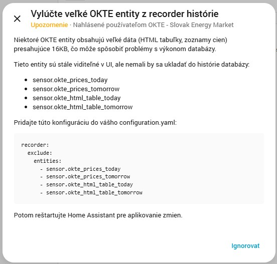

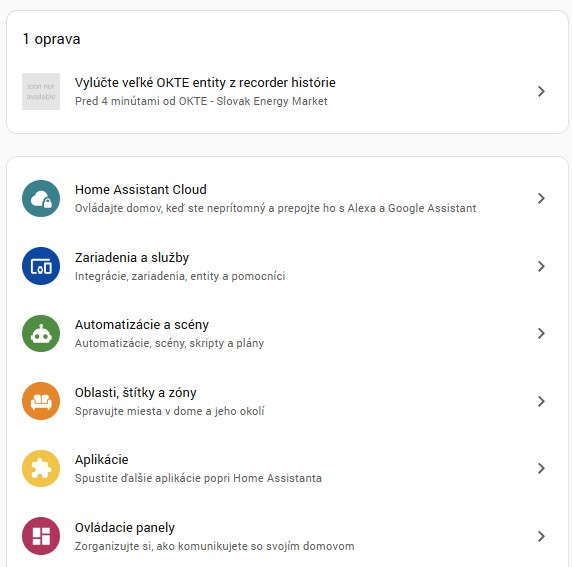

> 💡 **Poznámka:** Tieto entity budú stále perfektne fungovať vo vašich dashboardoch a automatizáciách - jednoducho sa nebudú ukladať do historických databázových záznamov.

---

## 📈 Cenové grafy

OKTE integrácia poskytuje cenové údaje dokonale formátované pre vizualizáciu pomocou **ApexCharts Card**. To vám umožňuje vytvoriť krásne, interaktívne cenové grafy.

### Predpoklady

Nainštalujte **ApexCharts Card** cez HACS:
1. Otvorte HACS → Frontend
2. Vyhľadajte "ApexCharts Card"
3. Nainštalujte a reštartujte Home Assistant

### Príklady grafov

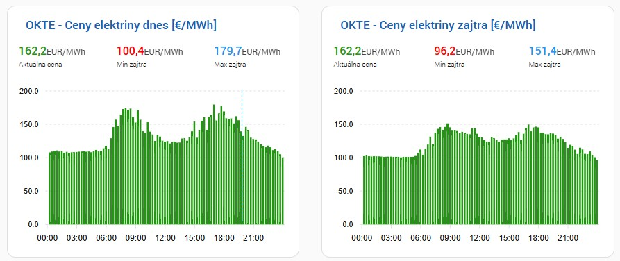

#### Graf dnešných cien

```yaml
type: custom:apexcharts-card
grid_options:
  columns: 12
  rows: auto
card_mod:
  style: |
    ha-card {
      min-width: 400px;
      padding: 0px 10px 0px 0px;
    }
    ha-card div#header__title {
      font-size: 17px !important;
      color:#1a60b2;
      padding: 5px 0px 10px 10px;
    }
apex_config:
  chart:
    zoom:
      autoScaleYaxis: false
  plotOptions:
    bar:
      columnWidth: 70%
graph_span: 24h
span:
  start: day
header:
  show: true
  title: OKTE - Ceny elektriny dnes [€/MWh]
  show_states: true
  colorize_states: true
now:
  show: true
experimental:
  color_threshold: true
series:
  - entity: sensor.okte_prices_today
    name: Cena €/MWh
    type: column
    color_threshold:
      - value: 0
        color: red
      - value: 0
        color: "#FFAA10"
      - value: 20
        color: "#219610"
      - value: 300
        color: "#2196F0"
    stroke_width: 0
    color: "#219610"
    data_generator: |
      const data = entity.attributes.period_data || [];
      return data
        .slice(0,96)
        .map((entry) => {
          return [new Date(entry.time).getTime(), entry.price];
        });
    show:
      extremas: false
      in_header: false
  - entity: sensor.okte_current_price
    name: Aktuálna cena
    color: "#219610"
    data_generator: |
      const now = new Date();
      const currentValue = parseFloat(entity.state);
      return [[now.getTime(), currentValue]];
    show:
      in_chart: false
      in_header: true
  - entity: sensor.okte_min_price_today
    name: Min dnes
    color: red
    data_generator: |
      const now = new Date();
      const minValue = parseFloat(entity.state);
      return [[now.getTime(), minValue]];
    show:
      in_chart: false
      in_header: true
  - entity: sensor.okte_max_price_today
    name: Max dnes
    color: "#2196F0"
    data_generator: |
      const now = new Date();
      const maxValue = parseFloat(entity.state);
      return [[now.getTime(), maxValue]];
    show:
      in_chart: false
      in_header: true
```

#### Graf zajtrajších cien

```yaml
type: custom:apexcharts-card
grid_options:
  columns: 12
  rows: auto
card_mod:
  style: |
    ha-card {
      min-width: 400px;
      padding: 0px 10px 0px 0px;
    }
    ha-card div#header__title {
      font-size: 17px !important;
      color:#1a60b2;
      padding: 5px 0px 10px 10px;
    }
apex_config:
  chart:
    zoom:
      autoScaleYaxis: false
  plotOptions:
    bar:
      columnWidth: 70%
graph_span: 24h
span:
  start: day
  offset: +1d
header:
  show: true
  title: OKTE - Ceny elektriny zajtra [€/MWh]
  show_states: true
  colorize_states: true
now:
  show: false
experimental:
  color_threshold: true
series:
  - entity: sensor.okte_prices_tomorrow
    name: Cena €/MWh
    type: column
    color_threshold:
      - value: 0
        color: red
      - value: 0
        color: "#FFAA10"
      - value: 20
        color: "#219610"
      - value: 300
        color: "#2196F0"
    stroke_width: 0
    color: "#219610"
    data_generator: |
      const data = entity.attributes.period_data || [];
      return data
        .slice(0,96)
        .map((entry) => {
          return [new Date(entry.time).getTime(), entry.price];
        });
    show:
      extremas: false
      in_header: false
  - entity: sensor.okte_min_price_tomorrow
    name: Min zajtra
    color: red
    data_generator: |
      const now = new Date();
      const minValue = parseFloat(entity.state);
      return [[now.getTime(), minValue]];
    show:
      in_chart: false
      in_header: true
  - entity: sensor.okte_max_price_tomorrow
    name: Max zajtra
    color: "#2196F0"
    data_generator: |
      const now = new Date();
      const maxValue = parseFloat(entity.state);
      return [[now.getTime(), maxValue]];
    show:
      in_chart: false
      in_header: true
```

### Funkcie grafov

- 📊 **Farebne kódované stĺpce** podľa cenových rozsahov
- 🎯 **Indikátor aktuálneho času** (dnešný graf)
- 📈 **Min/Max/Aktuálne ceny** v hlavičke
- 🖱️ **Interaktívny zoom** a bublinové tooltips
- 📱 **Responzívny dizajn** pre mobilné zariadenia

---

## 📋 HTML tabuľky cien

OKTE integrácia generuje plne formátované **HTML tabuľky** s farebne kódovanými cenami pre jednoduché zobrazenie.

### Predpoklady

Nainštalujte **HTML Template Card** cez HACS:
1. Otvorte HACS → Frontend
2. Vyhľadajte "HTML Template Card"
3. Nainštalujte a reštartujte Home Assistant

### Príklady tabuliek

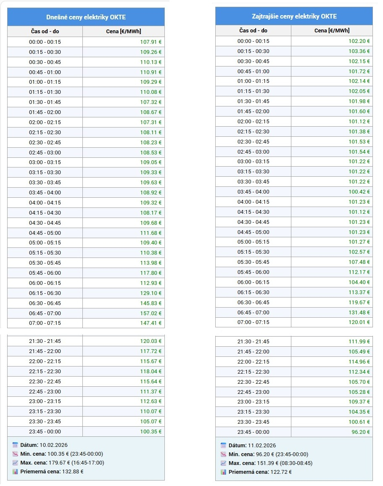

#### Tabuľka dnešných cien

```yaml
type: custom:html-template-card
content: >-
  
  
  
  
  <table border="1" cellpadding="5" cellspacing="0" style="border-collapse: collapse; width: 100%; max-width: 400px; border-color: color-mix(in srgb, var(--primary-text-color, #000000) 35%, transparent); color: var(--primary-text-color, #000000);">
  <thead>
  <tr style="background-color: var(--primary-color, #4a90e2); color: var(--text-primary-color, #ffffff);"><th colspan="2" style="text-align: center; font-size: 16px; padding: 10px;">Dnešné ceny elektriky OKTE</th></tr>
  <tr style="background-color: var(--secondary-background-color, #f2f2f2); color: var(--primary-text-color, #000000);"><th style="text-align: center; padding: 2px 7px;">Čas od - do</th><th style="text-align: center; padding: 2px 7px;">Cena [€/MWh]</th></tr>
  </thead>
  <tbody>
  
  <tr><td colspan="2" style="text-align: center; height: 200px; vertical-align: middle;">Údaje nie sú k dispozícii</td></tr>
  
  
  <tr style="background-color: {{ 'var(--card-background-color, #ffffff)' if loop.index0 % 2 == 0 else 'color-mix(in srgb, var(--primary-text-color, #000000) 6%, var(--card-background-color, #ffffff))' }};"><td style="text-align: center; padding: 1px 7px;">{{ p.period_start }} - {{ p.period_end }}</td><td style="text-align: right; color: {{ 'light-dark(#009000, #5fd35f)' if p.price > 20 else ('light-dark(#d08000, #ffb74d)' if p.price >= 0 else 'light-dark(#d00000, #ff6b6b)') }}; padding: 1px 7px;">{{ '%.2f' | format(p.price) }} €</td></tr>
  
  
  </tbody>
  
  
  
  
  <tfoot>
  <tr style="background-color: color-mix(in srgb, var(--primary-color, #4a90e2) 12%, var(--card-background-color, #ffffff));"><td colspan="2" style="padding: 10px; font-size: 14px;">
  <strong>📅 Dátum:</strong> {{ dr[2] }}.{{ dr[1] }}.{{ dr[0] }}<br>
  <strong>📉 Min. cena:</strong> {{ '%.2f' | format(mnp) }} € ({{ mn.period_start }}-{{ mn.period_end }})<br>
  <strong>📈 Max. cena:</strong> {{ '%.2f' | format(mxp) }} € ({{ mx.period_start }}-{{ mx.period_end }})<br>
  <strong>📊 Priemerná cena:</strong> {{ '%.2f' | format(state_attr('sensor.okte_prices_today', 'avg_price')) }} €
  </td></tr>
  </tfoot>
  
  </table>
  {{ out | replace('\n', '') | trim }}
```

#### Tabuľka zajtrajších cien

```yaml
type: custom:html-template-card
content: >-
  
  
  
  
  <table border="1" cellpadding="5" cellspacing="0" style="border-collapse: collapse; width: 100%; max-width: 400px; border-color: color-mix(in srgb, var(--primary-text-color, #000000) 35%, transparent); color: var(--primary-text-color, #000000);">
  <thead>
  <tr style="background-color: var(--primary-color, #4a90e2); color: var(--text-primary-color, #ffffff);"><th colspan="2" style="text-align: center; font-size: 16px; padding: 10px;">Zajtrajšie ceny elektriky OKTE</th></tr>
  <tr style="background-color: var(--secondary-background-color, #f2f2f2); color: var(--primary-text-color, #000000);"><th style="text-align: center; padding: 2px 7px;">Čas od - do</th><th style="text-align: center; padding: 2px 7px;">Cena [€/MWh]</th></tr>
  </thead>
  <tbody>
  
  <tr><td colspan="2" style="text-align: center; height: 200px; vertical-align: middle;">Údaje nie sú k dispozícii</td></tr>
  
  
  <tr style="background-color: {{ 'var(--card-background-color, #ffffff)' if loop.index0 % 2 == 0 else 'color-mix(in srgb, var(--primary-text-color, #000000) 6%, var(--card-background-color, #ffffff))' }};"><td style="text-align: center; padding: 1px 7px;">{{ p.period_start }} - {{ p.period_end }}</td><td style="text-align: right; color: {{ 'light-dark(#009000, #5fd35f)' if p.price > 20 else ('light-dark(#d08000, #ffb74d)' if p.price >= 0 else 'light-dark(#d00000, #ff6b6b)') }}; padding: 1px 7px;">{{ '%.2f' | format(p.price) }} €</td></tr>
  
  
  </tbody>
  
  
  
  
  <tfoot>
  <tr style="background-color: color-mix(in srgb, var(--primary-color, #4a90e2) 12%, var(--card-background-color, #ffffff));"><td colspan="2" style="padding: 10px; font-size: 14px;">
  <strong>📅 Dátum:</strong> {{ dr[2] }}.{{ dr[1] }}.{{ dr[0] }}<br>
  <strong>📉 Min. cena:</strong> {{ '%.2f' | format(mnp) }} € ({{ mn.period_start }}-{{ mn.period_end }})<br>
  <strong>📈 Max. cena:</strong> {{ '%.2f' | format(mxp) }} € ({{ mx.period_start }}-{{ mx.period_end }})<br>
  <strong>📊 Priemerná cena:</strong> {{ '%.2f' | format(state_attr('sensor.okte_prices_tomorrow', 'avg_price')) }} €
  </td></tr>
  </tfoot>
  
  </table>
  {{ out | replace('\n', '') | trim }}
```

### Funkcie tabuliek

- 🎨 **Farebne kódované ceny**:
  - 🟢 **Zelená**: Nízke ceny (vhodné pre spotrebu energie)
  - 🟡 **Žltá**: Stredné ceny
  - 🔴 **Červená**: Vysoké ceny (znížte spotrebu)
- 🕐 **Periodické rozčlenenie** od 00:00 do 23:59
- 💰 **Formátované ceny** s 2 desatinnými miestami
- 📱 **Responzívny dizajn** prispôsobený veľkosti obrazovky

---

## 🤖 Príklady automatizácií

OKTE integrácia poskytuje výkonné nástroje na vytváranie inteligentných energetických automatizácií založených na cenách elektriny.

### Príklad 1: Nabíjanie batérie počas najnižších cien

Automaticky nabíjajte batériu, keď sú ceny elektriny najnižšie:

```yaml
automation:
  - alias: "Batéria - Nabíjanie počas okna najnižšej ceny"
    description: "Nabíjať batériu keď je v okne najnižšej ceny"
    trigger:
      - platform: state
        entity_id: binary_sensor.okte_1_detector_lowest_price
        to: "on"
    condition:
      - condition: numeric_state
        entity_id: sensor.battery_level
        below: 80
    action:
      - service: switch.turn_on
        target:
          entity_id: switch.battery_charger
      - service: notify.mobile_app
        data:
          title: "⚡ Nabíjanie batérie spustené"
          message: "Nabíjanie počas obdobia nízkych cien ({{ states('sensor.okte_current_price') }} €/MWh)"
  
  - alias: "Batéria - Zastavenie nabíjania po okne najnižšej ceny"
    description: "Zastaviť nabíjanie keď skončí okno najnižšej ceny"
    trigger:
      - platform: state
        entity_id: binary_sensor.okte_1_detector_lowest_price
        to: "off"
    action:
      - service: switch.turn_off
        target:
          entity_id: switch.battery_charger
      - service: notify.mobile_app
        data:
          title: "🔋 Nabíjanie batérie zastavené"
          message: "Obdobie nízkych cien skončilo"
```

### Príklad 2: Prevádzka tepelného čerpadla počas nízkych cien

Optimalizujte prevádzku tepelného čerpadla na základe cien elektriny:

```yaml
automation:
  - alias: "Tepelné čerpadlo - Posilnenie počas nízkych cien"
    description: "Zvýšiť výkon tepelného čerpadla počas okna najnižšej ceny"
    trigger:
      - platform: state
        entity_id: binary_sensor.okte_2_detector_lowest_price
        to: "on"
    condition:
      - condition: numeric_state
        entity_id: sensor.outdoor_temperature
        below: 5
    action:
      - service: climate.set_temperature
        target:
          entity_id: climate.heat_pump
        data:
          temperature: 23
      - service: number.set_value
        target:
          entity_id: number.heat_pump_power_limit
        data:
          value: 100
```

### Príklad 3: Vyhýbanie sa obdobiam vysokých cien

Znížte spotrebu energie počas najdrahších období:

```yaml
automation:
  - alias: "Energia - Zníženie spotreby počas vysokých cien"
    description: "Vypnúť nevyhnutné zariadenia počas okna najvyššej ceny"
    trigger:
      - platform: state
        entity_id: binary_sensor.okte_3_detector_highest_price
        to: "on"
    action:
      - service: switch.turn_off
        target:
          entity_id:
            - switch.electric_water_heater
            - switch.pool_pump
            - switch.ev_charger
      - service: notify.mobile_app
        data:
          title: "⚠️ Obdobie vysokých cien"
          message: "Nevyhnutné zariadenia vypnuté ({{ states('sensor.okte_current_price') }} €/MWh)"
```

### Príklad 4: Dynamické nastavenie veľkosti okna

Automaticky upravte veľkosť cenového okna na základe úrovne batérie:

```yaml
automation:
  - alias: "Batéria - Úprava veľkosti nabíjacieho okna"
    description: "Zvýšiť nabíjacie okno keď je batéria veľmi nízka"
    trigger:
      - platform: numeric_state
        entity_id: sensor.battery_level
        below: 20
    action:
      - service: number.set_value
        target:
          entity_id: number.okte_1_lowest_price_window_size
        data:
          value: 6
  
  - alias: "Batéria - Normálna veľkosť nabíjacieho okna"
    description: "Použiť normálnu veľkosť okna keď je batéria OK"
    trigger:
      - platform: numeric_state
        entity_id: sensor.battery_level
        above: 50
    action:
      - service: number.set_value
        target:
          entity_id: number.okte_1_lowest_price_window_size
        data:
          value: 3
```

### Príklad 5: Upozornenie na ceny

Dostávajte upozornenia o zajtrajšom okne najnižšej ceny:

```yaml
automation:
  - alias: "OKTE - Upozornenie na zajtra najnižšiu cenu"
    description: "Poslať upozornenie s zajtrajším najlacnejším časom"
    trigger:
      - platform: time
        at: "14:30:00"
    action:
      - service: notify.mobile_app
        data:
          title: "⚡ Zajtrajšie okno najnižšej ceny"
          message: >
            Najnižšie ceny zajtra:
            {{ state_attr('sensor.okte_1_lowest_price_window_tomorrow', 'start_time') }} - 
            {{ state_attr('sensor.okte_1_lowest_price_window_tomorrow', 'end_time') }}
            Priemer: {{ state_attr('sensor.okte_1_lowest_price_window_tomorrow', 'average_price') }} €/MWh
```

### Tipy pre automatizácie

💡 **Najlepšie postupy:**

1. **Použite viacero Calculator zariadení** pre rôzne spotrebiče (batéria, tepelné čerpadlo, ohrievač vody)
2. **Upravte veľkosti okien** podľa vašich potrieb (3h pre batériu, 6h pre tepelné čerpadlo)
3. **Kombinujte cenové detektory** s ďalšími podmienkami (teplota, úroveň batérie)
4. **Nastavte prepínače východu/západu slnka** pre prirodzenejšie automatizačné vzory
5. **Používajte upozornenia** na informovanie o zmenách cien

---

## 🔧 Riešenie problémov

### Integrácia sa nenačíta

1. **Skontrolujte logy** v Nastavenia → Systém → Logy
2. **Overte inštaláciu** - súbory by mali byť v `custom_components/okte/`
3. **Reštartujte Home Assistant** po inštalácii
4. **Vymažte cache prehliadača** ak UI nezobrazuje integráciu

### Žiadne údaje / Nedostupné senzory

1. **Skontrolujte OKTE Master pripojenie**: Overte, že `sensor.okte_connection_status` je "Pripojené"
2. **Manuálne spustite stiahnutie údajov**: Stlačte `button.okte_update_data`
3. **Overte čas sťahovania**: Uistite sa, že je po 13:00, keď OKTE zverejňuje ceny
4. **Skontrolujte dostupnosť API**: OKTE API môže byť dočasne nedostupné

### Okno Calculator sa neaktualizuje

1. **Overte nastavenia časového rozsahu** v konfigurácii Calculator
2. **Skontrolujte veľkosť okna** - uistite sa, že nie je väčšia ako vyhľadávací rozsah
3. **Overte OKTE Master** má platné údaje
4. **Skontrolujte prepínače východu/západu slnka** - môžu prepísať manuálne časy

### Problémy s výkonom databázy

1. **Implementujte vylúčenia recordera** ako je popísané v [Optimalizácia databázy](#-optimalizácia-databázy)
2. **Reštartujte Home Assistant** po pridaní vylúčení
3. **Vyčistite staré údaje**: Developer Tools → Services → `recorder.purge`

### Grafy sa nezobrazujú

1. **Nainštalujte ApexCharts Card** cez HACS
2. **Vymažte cache prehliadača**
3. **Skontrolujte ID entít** v konfigurácii karty zodpovedajú názvom vašich zariadení
4. **Overte údaje senzora**: Skontrolujte, či `sensor.okte_prices_today` má atribút `period_data`

---

## 💬 Podpora

### 📧 Kontakt & Odkazy

- **GitHub repozitár**: [https://github.com/jozef-moravcik-homeassistant/okte](https://github.com/jozef-moravcik-homeassistant/okte)
- **Hlásenia chýb**: [GitHub Issues](https://github.com/jozef-moravcik-homeassistant/okte/issues)
- **Autor**: Jozef Moravčík
- **Email**: jozef.moravcik@moravcik.eu

### 🐛 Hlásenie problémov

Pri hlásení problémov prosím uveďte:
1. Verziu Home Assistant
2. Verziu OKTE integrácie
3. Relevantné záznamy z Nastavenia → Systém → Logy
4. Kroky na reprodukciu problému
5. Snímky obrazovky, ak je to možné

### ⭐ Ukážte svoju podporu

Ak považujete túto integráciu za užitočnú, zvážte prosím:
- ⭐ **Označte repozitár hviezdičkou** na GitHub
- 🐛 **Nahláste chyby** alebo navrhnite funkcie
- 📝 **Zdieľajte svoje príklady automatizácií** s komunitou
- ☕ **Kúpte mi kávu** (odkaz na darovanie v repozitári)

---

## 📜 Licencia

Tento projekt je licencovaný pod MIT licenciou - pozrite súbor [LICENSE](LICENSE) pre podrobnosti.

---

## 🙏 Poďakovania

- **OKTE** (Operátor krátkodobého trhu s elektrinou) za poskytovanie verejného API
- **Home Assistant komunita** za neustálu podporu a inšpiráciu
- **Všetci prispievatelia** ktorí pomôžu vylepšiť túto integráciu

---

<div align="center">

**[⬆ Späť na začiatok](#-okte---integrácia-slovenského-trhu-s-elektrinou-pre-home-assistant)**

Vytvorené s ❤️ pre Home Assistant komunitu

</div>
